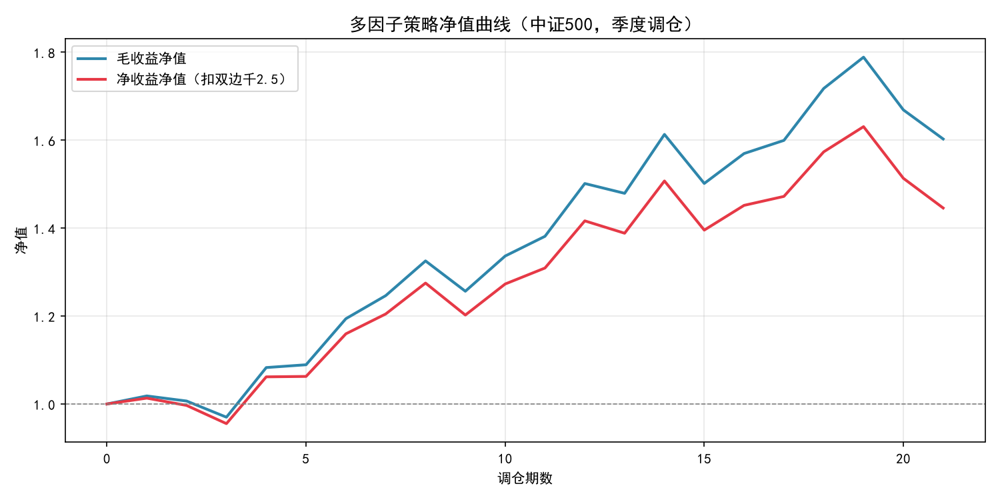
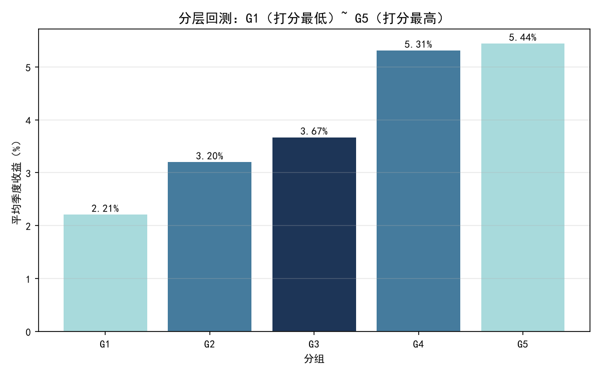

# 中证500多因子选股策略

基于量价因子的中证500多空策略。包含数据获取、因子计算、因子筛选、IC 检验、分层回测、绩效评估的完整流程，支持季度调仓与交易成本建模。

## 核心结果

**回测区间**：2020-01 ~ 2025-10  
**调仓频率**：季度（年化因子 = 4）  
**股票池**：中证500成分股（297只）  
**样本期数**：21 期  
**多空组合**：综合打分前25%做多，后25%做空  
**交易成本**：双边千2.5

| 指标 | 毛收益 | 净收益 |
|------|--------|--------|
| 累计收益 | +98.38% | +79.13% |
| 年化收益 | 13.94% | 11.74% |
| 年化波动 | 14.71% | 14.71% |
| 夏普比率 | 0.95 | 0.80 |
| t 值 | 2.22 | 1.90 |
| 最大回撤 | -12.36% | -14.58% |
| 胜率 | 66.7% | 66.7% |

样本 21 期。毛收益 t=2.22，在 5% 水平显著；净收益 t=1.90，未达到 5% 显著性水平（临界值 2.086）。



### 分层回测

| 分组 | 平均季度收益 |
|------|-------------|
| G1（打分最低） | 2.21% |
| G2 | 3.20% |
| G3 | 3.67% |
| G4 | 5.31% |
| G5（打分最高） | 5.44% |

单调性严格递增，G5-G1 = 3.23%。



## 因子筛选过程

原始方案用 5 个因子等权合成，毛夏普 0.84，分层非单调。逐因子分层检验：

| 因子 | 含义 | G5-G1 | 单调性 | 结论 |
|------|------|-------|--------|------|
| reversal | 20日反转 | +3.35% | 递增 | 保留 |
| ma_ratio | MA5/MA20-1 | +3.22% | 递增 | 保留 |
| volatility | 20日波动率 | -0.46% | 非单调 | 剔除 |
| avg_turn | 20日换手率 | +0.46% | 非单调 | 剔除 |
| EP | 盈利收益率 | +0.09% | 非单调 | 剔除 |

仅保留 reversal 和 ma_ratio，毛夏普从 0.84 提升至 0.98。

## 因子权重

采用 IC_IR 加权为基准，对 ma_ratio 权重做敏感性测试：

| w_ma | 净夏普 | 净 t 值 |
|------|--------|---------|
| 0.3  | 0.69   | 1.59    |
| 0.4  | 0.71   | 1.62    |
| 0.5  | 0.77   | 1.77    |
| 0.6  | 0.83   | 1.91    |
| 0.7  | 0.87   | 2.00    |
| 0.8  | 0.83   | 1.90    |

夏普在 0.6~0.8 区间稳定在 0.83 以上，对权重不敏感。最终取 0.6/0.4，主动避开峰值 0.7，避免样本内过拟合。

## 因子预处理

1. 去极值：3 倍 MAD
2. 标准化：排名百分位，输出 [-0.5, 0.5]
3. 方向统一：按因子方向取反

## 项目结构

```
.
├── config.py              # 全局配置（因子、权重、成本）
├── data_loader.py         # baostock 数据获取与缓存
├── factor_calc.py         # 量价因子计算
├── fundamental.py         # 基本面数据
├── valuation.py           # 估值因子（EP）
├── preprocess.py          # 去极值、标准化、方向统一
├── ic_analysis.py         # IC 检验
├── industry.py            # 行业分类（中性化用，默认关闭）
├── backtest.py            # 期收益计算
├── main.py                # 主入口
├── src/
│   ├── signal/combine.py      # 因子合成
│   ├── backtest/metrics.py    # 绩效指标
│   └── evaluation/layered.py  # 分层回测
├── tests/                 # 单元测试
├── conftest.py
├── pytest.ini
└── requirements.txt
```

## 测试

```bash
pytest tests/ -v
```

6 个测试，含：

- `test_no_lookahead`：验证因子计算不使用未来数据
- `test_standardize_range`：验证标准化输出在 [-0.5, 0.5]
- `test_sharpe_known_value`：手算夏普对比

## 运行方式

```bash
pip install -r requirements.txt
python main.py
python plot_results.py
```

首次运行通过 baostock 拉取数据并缓存到 `data/`，后续直接读缓存。

## 分时段检验（训练期 vs 验证期）

由于前期探索曾使用全样本，本处的划分属于“固定参数后的分时段检验”，保证首尾相接且不重叠。
- **训练期**：2020-01 ~ 2023-06（13期），用于观察因子表现及选择权重 0.4/0.6。
- **验证期**：2023-07 ~ 2025-10（8期），权重完全冻结。

| 区间 | 样本期数 | 毛夏普 | 净夏普 | 胜率 | 分层单调性 |
|------|----------|--------|--------|------|------------|
| 全样本 | 21期 | 0.95 | 0.80 | 66.7% | 递增 |
| 训练期 | 13期 | 1.45 | 1.28 | 76.9% | 递增 |
| 验证期 | 8期 | 0.31 | 0.18 | 50.0% | 非单调 |

**失效分析**：
样本外表现出现显著衰减。验证期（2023-2025）的 IC 均值骤降至接近 0，分层不再单调。这证明了该策略超额收益具有强烈的风格暴露（反转因子）。在 2023 年后的市场环境下，单纯的反转因子遭遇了风格切换的打击。考虑到验证期仅 8 期，样本量较小，这提示后续研究不应继续在样本内调参，而应引入动态因子权重或风格择时机制。

## 尝试过但未采用的方案

**行业中性化**：用 baostock 行业分类（19 个门类），对每个因子减去行业均值。  
结果：毛夏普从 0.98 降至 0.66，分层从递增变为非单调。  
原因：本策略 alpha 主要来自行业间差异，中性化后信号被削弱。  
代码保留在 `industry.py`，开关 `USE_INDUSTRY_NEUTRAL` 默认关闭。

**波动率目标**：用滚动 8 期已实现波动估计下期仓位，目标年化波动 10% / 12%。

| 目标 | 毛夏普 | 净夏普 | 毛回撤 | 净回撤 |
|------|--------|--------|--------|--------|
| 无   | 0.98   | 0.83   | -12.02% | -14.25% |
| 10%  | 0.93   | 0.81   | -8.82%  | -10.31% |
| 12%  | 0.95   | 0.82   | -10.15% | -12.08% |

结果：回撤改善 4pp，但夏普下降 0.03。原因是季度调仓频率下仓位调整滞后，波动估计不稳。代码保留在 `main.py`，开关 `USE_VOL_TARGET` 默认关闭。

## 已知局限

- 使用当前中证500成分股，存在幸存者偏差
- 未做行业中性化（实测降夏普）
- 样本仅 21 期，净收益 t=1.90 未达到 5% 显著性水平
- 季度调仓年化收益偏低，但换手率低、成本可控
- 目前所有回测均为样本内（2020-2025），未做严格的训练/验证集切割
- 目前仅按季度净值计算最大回撤，可能低估期内波动

## 后续改进方向

- 用历史成分股消除幸存者偏差
- 加更多低相关因子，先经单因子分层验证
- 用日频数据做波动率估计
